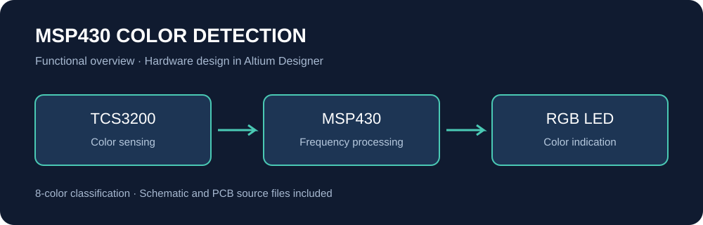

# MSP430 Color Detection System

An embedded color detection project based on an **MSP430 microcontroller** and a **TCS3200 color sensor**, with custom schematic and PCB design files created in **Altium Designer**.

## PCB files

- [Main PCB design — renkpcb.PcbDoc](hardware/renkpcb.PcbDoc)
- [Additional PCB design — renkpcb2.PcbDoc](hardware/renkpcb2.PcbDoc)
- [Circuit schematic — sema.SchDoc](hardware/sema.SchDoc)

These links open the original Altium files on GitHub. Download them to view the design in Altium Designer. The diagram above is a functional overview, not a PCB rendering.

## Project overview

The system processes frequency output from the TCS3200 sensor to detect and classify eight different colors. The detected color is indicated using an RGB LED.

The functional description above reflects the project summary in the author's CV. This repository currently contains the hardware design files; firmware and experimental results are not included.

## Technologies

- MSP430 microcontroller
- TCS3200 color sensor
- RGB LED
- C / Code Composer Studio (firmware development)
- Altium Designer (schematic and PCB design)

## Repository contents

| File | Description |
| --- | --- |
| `hardware/MSP430-RENK-ALGILAMA.PrjPcb` | Altium Designer project |
| `hardware/MSP430-RENK-ALGILAMA.PrjPcbStructure` | Project structure metadata |
| `hardware/sema.SchDoc` | Circuit schematic |
| `hardware/renkpcb.PcbDoc` | PCB document referenced by the project |
| `hardware/renkpcb2.PcbDoc` | Additional PCB document supplied with the project |

## Opening the design

1. Download or clone this repository.
2. Open `hardware/MSP430-RENK-ALGILAMA.PrjPcb` in Altium Designer.
3. Open `sema.SchDoc` and `renkpcb.PcbDoc` from the project.
4. To inspect the additional PCB document, open `renkpcb2.PcbDoc` separately.

The project file also references generated manufacturing and report outputs that are not included. Regenerate them from Altium Designer as needed. External component libraries may need to be resolved in your local Altium installation.

## Scope

- Included: original Altium project, schematic, and two PCB documents.
- Not included: C firmware, calibration data, test measurements, Gerber exports, or build instructions for firmware.
- Hardware operation and manufacturing readiness have not been validated as part of this repository upload.

## Author

İrem Buğday
